# TRAMA — Electronic Process & Records Management for the Public Sector

**🇧🇷 [Leia em português](README.pt-BR.md)**

TRAMA is a multi-tenant SaaS platform for government bodies (city halls,
departments, public agencies). It handles the full life of an administrative
document: drafting, routing through approval workflows, electronic and
ICP-Brasil digital signatures, archival classification, retention schedules and
long-term preservation, all under LGPD (Brazil's data protection law) and full
audit traceability.

> **This is a showcase repository.** The product source code is private.
> Here you will find the architecture, a selection of the actual Architecture
> Decision Records, representative code excerpts and screenshots taken from a
> local environment populated with **100% synthetic data** ("Órgão de
> Demonstração" is a fictitious organization).

  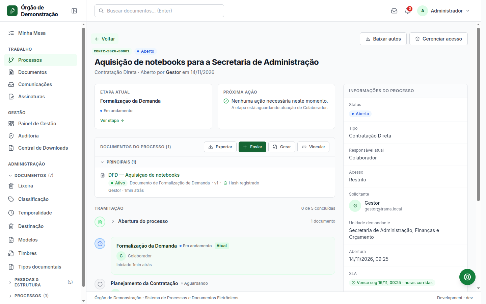

---

## At a glance

| | |
|---|---|
| **Period** | June 2026 – present |
| **My role** | Full-stack developer |
| **Backend** | NestJS (TypeScript), modular monolith, 15 domain modules |
| **Frontend** | React 18 + TypeScript + Vite (SPA, PWA) |
| **Data** | PostgreSQL 15 with Row Level Security, 212 migrations, PostgreSQL full-text search |
| **Async** | Redis 7 + Bull queues (OCR with Tesseract, PDF stamping, thumbnails, indexing, e-mail, exports) |
| **Real time** | WebSocket per resource with Redis adapter and graceful fallback |
| **Storage** | S3 API (AWS S3 with SSE-KMS in production, S3 emulator locally) |
| **Auth** | JWT RS256 with rotating refresh tokens, immediate revocation by security version, TOTP |
| **Infra** | AWS (`sa-east-1`), Terraform, Docker Compose, immutable image tags |
| **Size** | ~375k lines of TypeScript · ~650 test files · 304 HTTP routes under an executable access matrix |
| **Governance** | 45 ADRs · 69 capability specs · 650+ spec-driven changes (OpenSpec) |

---

## What the product does

- **Administrative processes** with configurable workflows: steps, SLA in
  business or calendar hours, segregation of duties, return/reject/complete,
  delegation and per-unit triage.
- **Documents** with immutable versions, templates with letterheads, numbering
  per type and unit, OCR, full-text search and controlled distribution to
  internal and external recipients with acknowledgement receipts.
- **Signatures**: simple electronic signature with TOTP and **ICP-Brasil (A1/A3)
  digital signatures** through an external signing bridge. The backend never
  touches private keys, certificate files or PINs. Supports sequential or
  parallel signature plans tied to workflow steps, and public verification by code.
- **Records management**: hierarchical classification plan, retention schedule,
  disposition batches decided by a records committee, legal holds and trash
  with restore rules.
- **Audit and compliance**: audit trail of actions and accesses with CSV export, LGPD data
  minimization in responses, masked national IDs (CPF/CNPJ) and a documented
  legal basis for every personal field.
- **Operations**: management dashboard, "My Desk" inbox, notifications,
  support tickets and an in-app help center.

---

## Architecture

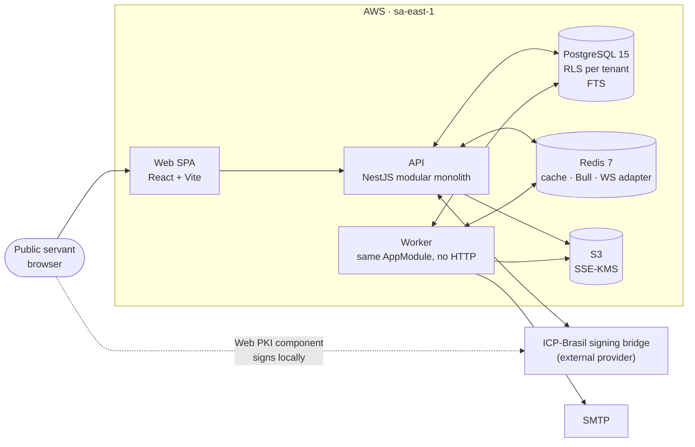

Key design points (details in [docs/architecture.md](docs/architecture.md)):

1. **Modular monolith** ([ADR-001](docs/adrs/ADR-001-arquitetura-monolitica-modular-para-mvp.md)).
   Bounded modules (`auth`, `documents`, `workflows`, `signatures`, `archival`,
   `audit`…) talk through explicit exports and events, not cross imports. The
   same `AppModule` boots as HTTP API or as queue worker.
2. **Tenant isolation enforced by the database**
   ([ADR-002](docs/adrs/ADR-002-multi-tenancy-logico-shared-database.md)).
   Every transaction runs `SET LOCAL ROLE` to a restricted role and sets
   `app.tenant_id`. `FORCE ROW LEVEL SECURITY` policies then filter every
   tenant-scoped table. A custom type-aware ESLint rule rejects repository calls
   outside that transaction.
3. **One access predicate per resource**
   ([ADR-048](docs/adrs/ADR-048-politica-de-acesso-por-recurso.md)). Each domain
   declares its access sources once, as SQL fragments. Listing, by-ID checks
   and "can user X act on this?" all compose the **same** predicate, so the
   three can no longer drift apart.
4. **Executable route access matrix**
   ([ADR-049](docs/adrs/ADR-049-matriz-de-acesso-por-rota.md)). All 304 HTTP
   routes declare their guards, resource policies, mutations and blocking
   states. A test fails if a route is missing from the matrix, and per-route
   cases prove each protection against a real database.
5. **Version-level immutability**
   ([ADR-036](docs/adrs/ADR-036-imutabilidade-documental-e-da-versao.md)). A
   signed version never changes, and corrections create new versions or
   rectifications.
6. **Zero custody of signing keys**
   ([ADR-042](docs/adrs/ADR-042-lacuna-como-via-unica-de-assinatura-icp-brasil.md)).
   The certificate stays in the user's browser or token, and the backend only
   validates the structure of the returned PAdES PDF.

---

## Engineering practices

- **Spec-driven development**: every functional change starts as an
  [OpenSpec](https://openspec.dev/) change (proposal → design → spec deltas →
  tasks) and is archived only after validation. The REST contract is exported
  to OpenAPI from the specs.
- **Architecture Decision Records**: 45 ADRs, each with status (current,
  historical, revoked) and an explicit successor. Selected ADRs are in
  [docs/adrs](docs/adrs).
- **Quality gates**: a pre-push gate runs lint, typecheck, 16 policy checkers
  (env contract, seed policy, route matrix, docs drift…), unit, integration
  and e2e suites. A width guard test keeps every page on the design system's
  layout.
- **Independent adversarial review**: any change touching authorization,
  personal data or lifecycle rules is reviewed, before coding, by a separate
  session that only sees the artifacts and must answer a fixed checklist with
  measured data.
- **Operations**: backup/restore drills, disaster-recovery exercise,
  structured JSON logging with request/tenant/user correlation, health
  endpoint reporting the deployed commit.

---

## Code samples

Short, unmodified excerpts from the private repository. See
[code-samples/README.md](code-samples/README.md) for context.

| File | What it shows |
|---|---|
| [01-tenant-rls.subscriber.ts](code-samples/01-tenant-rls.subscriber.ts) | Tenant context injected into every PostgreSQL transaction + the RLS policy |
| [02-access-policy.ts](code-samples/02-access-policy.ts) | Composable SQL predicates for resource access, fail-closed by default |
| [03-route-access-matrix.ts](code-samples/03-route-access-matrix.ts) | Type model of the route access matrix and one real entry |
| [04-pdf-structural-signature-validator.ts](code-samples/04-pdf-structural-signature-validator.ts) | Validation of `/ByteRange`, CMS and timestamp token in a PAdES PDF |
| [05-eslint-no-repo-outside-transaction.js](code-samples/05-eslint-no-repo-outside-transaction.js) | Custom type-aware lint rule protecting tenant isolation |

---

## Screenshots

All data is synthetic.

| | |
|---|---|
| 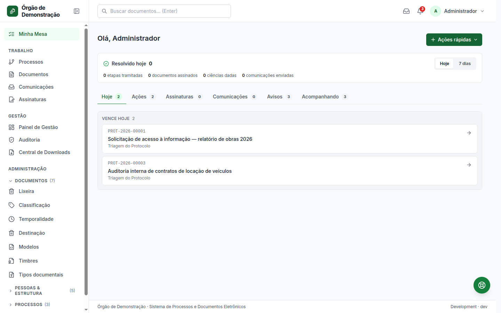 **My Desk**: tasks due, signatures, acknowledgements | 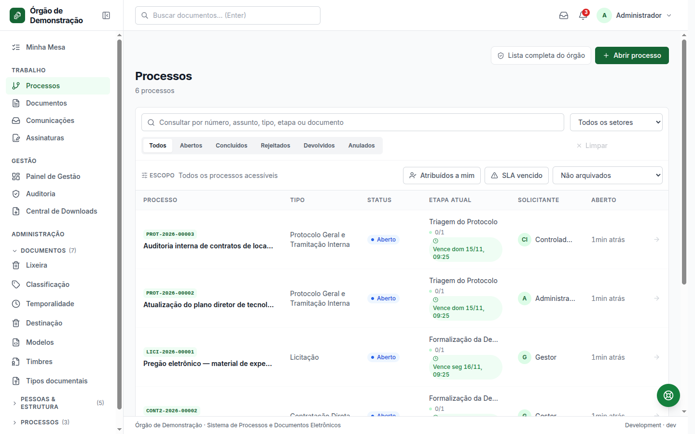 **Processes**: current step, SLA, requester |
|  **Process detail**: documents, workflow timeline, SLA | 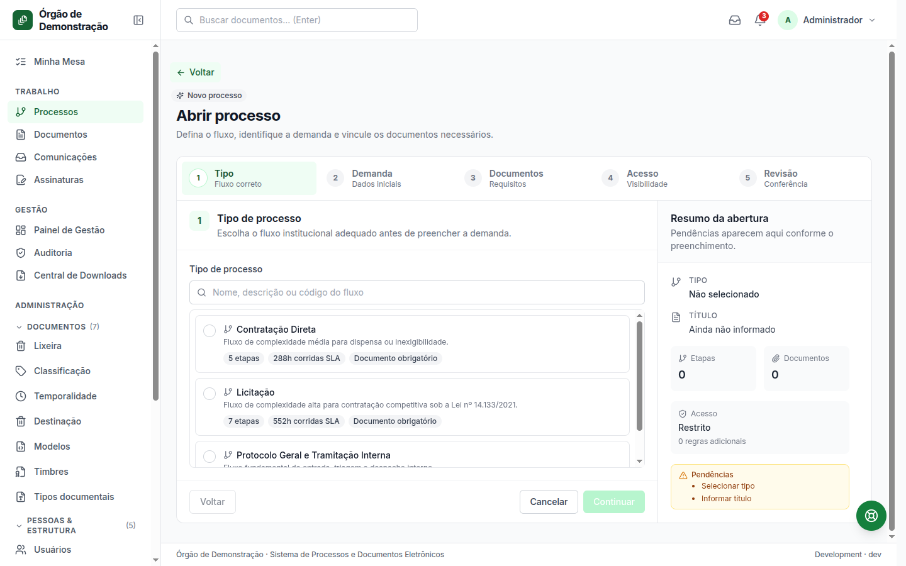 **Open process**: guided wizard |
| 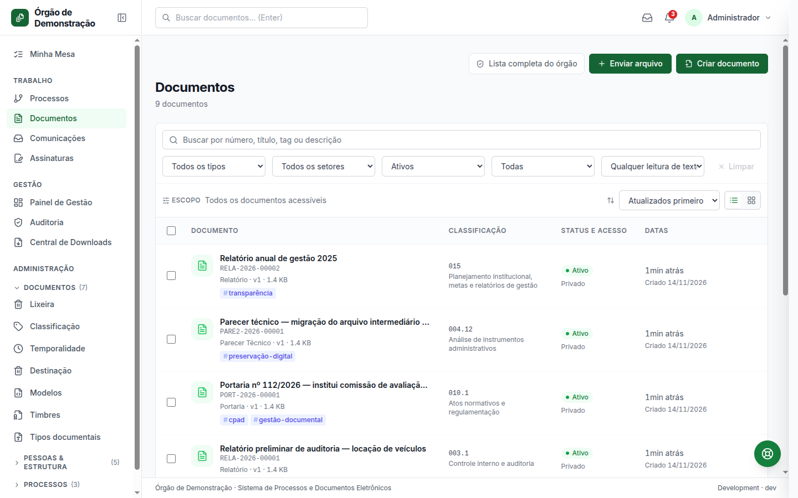 **Documents**: classification, access, versions | 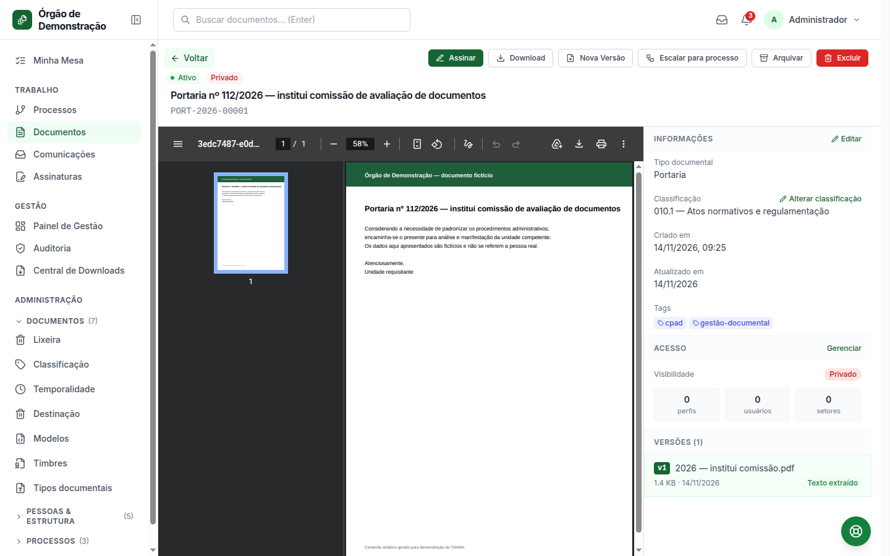 **Document viewer**: metadata, ACL, versions |
| 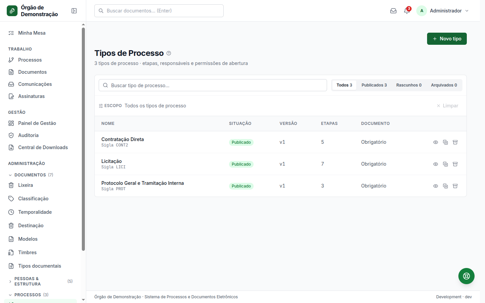 **Workflow types**: versioned and published | 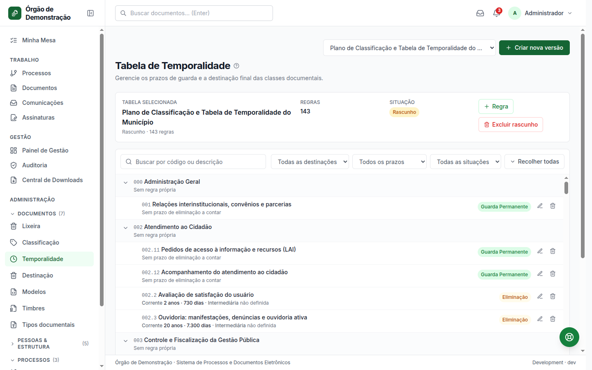 **Retention schedule**: retention periods and final disposition |
| 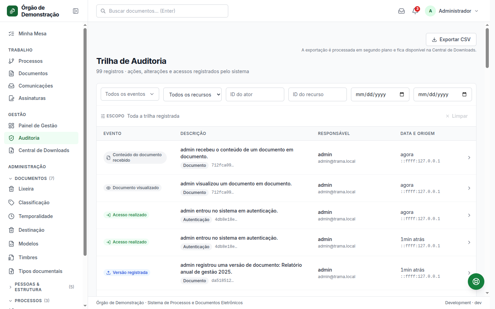 **Audit trail**: who did what, when, from where | 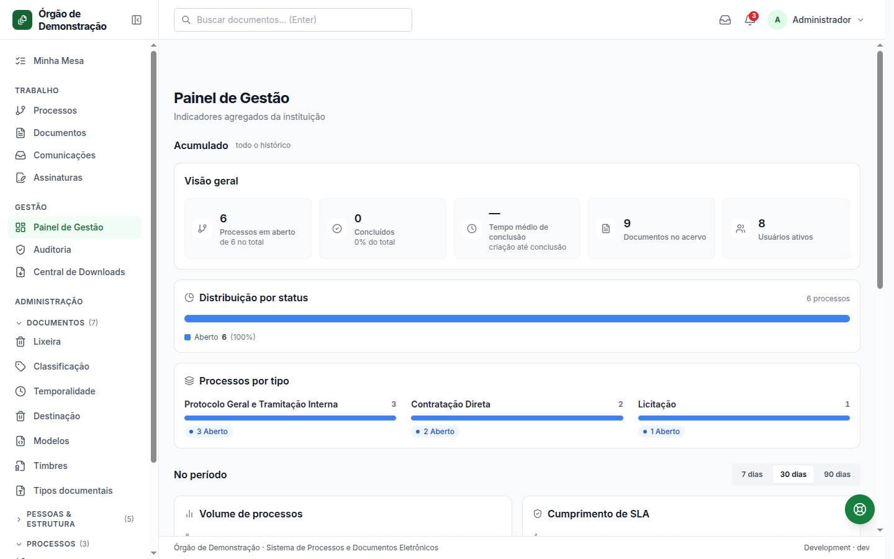 **Management dashboard** |

---

## About this repository

- No production data, credentials, hostnames or infrastructure details are
  included.
- ADRs are kept in their original language (Brazilian Portuguese). References
  to internal paths and finding IDs point to the private repository.
- Contact: robertoromeu2009@gmail.com
