# TRAMA — Gestão Eletrônica de Processos, Documentos e Arquivos para o Setor Público

**🇺🇸 [Read in English](README.md)**

O TRAMA é uma plataforma SaaS multi-tenant para órgãos públicos (prefeituras,
secretarias, autarquias). Ela cobre a vida inteira do documento administrativo:
criação, tramitação por fluxos de aprovação, assinatura eletrônica e ICP-Brasil,
classificação arquivística, tabela de temporalidade e preservação, com
rastreabilidade completa e aderência à LGPD.

> **Este é um repositório de vitrine.** O código-fonte do produto é privado.
> Aqui estão a arquitetura, uma seleção dos ADRs reais, trechos
> representativos de código e capturas de tela feitas num ambiente local com
> **massa 100% sintética**. O "Órgão de Demonstração" é fictício.

  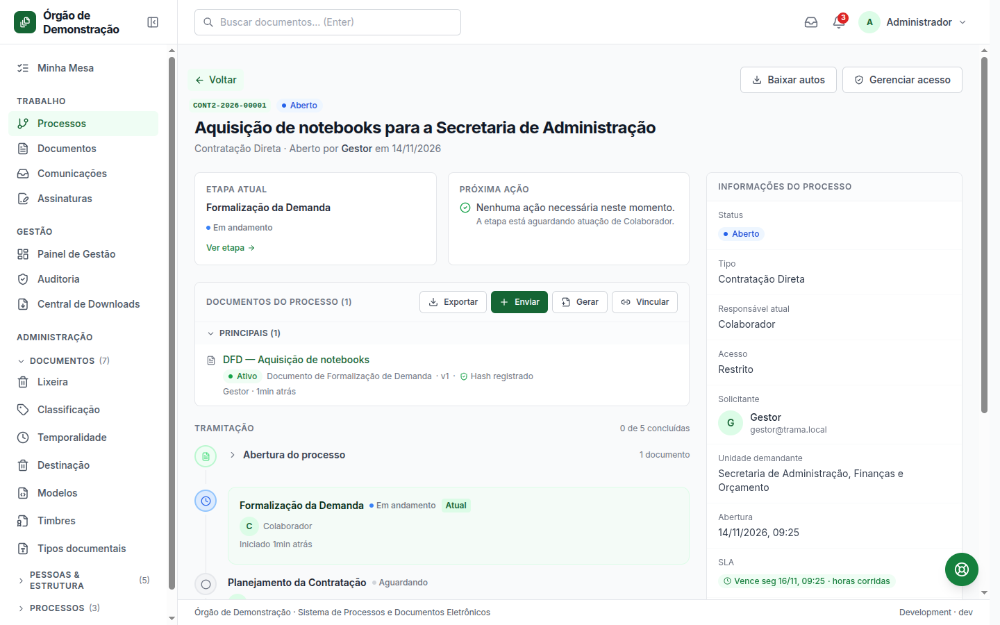

---

## Em números

| | |
|---|---|
| **Período** | junho de 2026 – atual |
| **Meu papel** | Desenvolvedor full-stack |
| **Backend** | NestJS (TypeScript), monolito modular, 15 módulos de domínio |
| **Frontend** | React 18 + TypeScript + Vite (SPA, PWA) |
| **Dados** | PostgreSQL 15 com Row Level Security, 212 migrations, busca full-text no PostgreSQL |
| **Assíncrono** | Redis 7 + Bull (OCR com Tesseract, carimbo de PDF, miniaturas, indexação, e-mail, exportações) |
| **Tempo real** | WebSocket orientado a recurso, com adapter Redis e fallback gracioso |
| **Storage** | API S3 (AWS S3 com SSE-KMS em produção, emulador S3 local) |
| **Autenticação** | JWT RS256 com refresh rotativo, revogação imediata por versão de segurança, TOTP |
| **Infra** | AWS (`sa-east-1`), Terraform, Docker Compose, tags de imagem imutáveis |
| **Tamanho** | ~375 mil linhas de TypeScript · ~650 arquivos de teste · 304 rotas HTTP sob matriz de acesso executável |
| **Governança** | 45 ADRs · 69 specs de capacidade · mais de 650 changes guiadas por spec (OpenSpec) |

---

## O que o produto faz

- **Processos administrativos** com fluxos configuráveis: etapas, SLA em horas
  úteis ou corridas, segregação de funções, devolução, recusa e conclusão,
  delegação e triagem por unidade.
- **Documentos** com versões imutáveis, modelos com timbre, numeração por tipo
  e unidade, OCR, busca textual e distribuição controlada a destinatários
  internos e externos, com registro de ciência.
- **Assinaturas**: assinatura eletrônica simples com TOTP e **assinatura
  digital ICP-Brasil (A1/A3)** por ponte com provedor externo. O backend nunca
  toca chave privada, arquivo de certificado ou PIN. Há planos de assinatura
  sequenciais ou paralelos ligados a etapas do fluxo e verificação pública por
  código.
- **Gestão arquivística**: plano de classificação hierárquico, tabela de
  temporalidade, lotes de destinação decididos por comissão (CPAD), retenção
  por bloqueio e lixeira com regras de restauração.
- **Auditoria e conformidade**: trilha de ações e acessos com exportação CSV,
  minimização de dados pessoais nas respostas, CPF/CNPJ mascarado e base legal
  documentada para cada dado pessoal.
- **Operação**: painel de gestão, "Minha Mesa", notificações, chamados de
  suporte e central de ajuda.

---

## Arquitetura

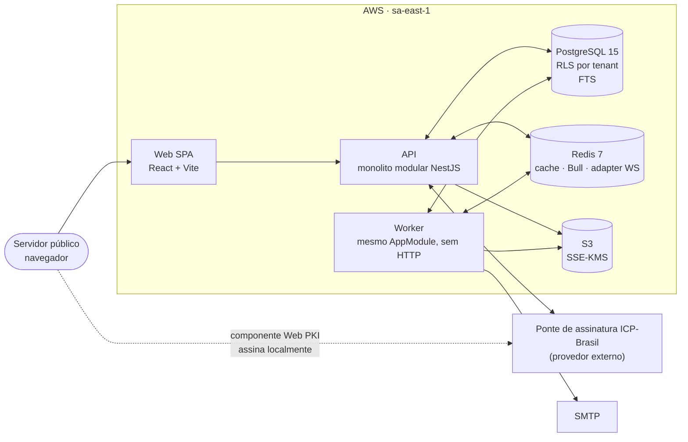

Pontos centrais do desenho (detalhes em [docs/architecture.md](docs/architecture.md), em inglês):

1. **Monolito modular** ([ADR-001](docs/adrs/ADR-001-arquitetura-monolitica-modular-para-mvp.md)).
   Os módulos de domínio (`auth`, `documents`, `workflows`, `signatures`,
   `archival`, `audit`…) se comunicam por exports explícitos e eventos, não por
   import cruzado. O mesmo `AppModule` sobe como API HTTP ou como worker de
   filas.
2. **Isolamento de tenant garantido pelo banco**
   ([ADR-002](docs/adrs/ADR-002-multi-tenancy-logico-shared-database.md)).
   Toda transação faz `SET LOCAL ROLE` para um papel restrito e grava
   `app.tenant_id`. As políticas com `FORCE ROW LEVEL SECURITY` filtram cada
   tabela do tenant. Uma regra de ESLint type-aware própria reprova chamada de
   repositório fora dessa transação.
3. **Um predicado de acesso por recurso**
   ([ADR-048](docs/adrs/ADR-048-politica-de-acesso-por-recurso.md)). Cada
   domínio declara suas fontes de acesso uma única vez, como fragmentos SQL.
   Listagem, checagem por ID e "o usuário X pode agir aqui?" compõem o
   **mesmo** predicado, então não divergem mais entre si.
4. **Matriz de acesso por rota, executável**
   ([ADR-049](docs/adrs/ADR-049-matriz-de-acesso-por-rota.md)). As 304 rotas
   HTTP declaram guards, política de recurso, o que mutam e os estados que
   bloqueiam. Um teste reprova rota fora da matriz, e casos por rota provam
   cada proteção contra um banco real.
5. **Imutabilidade da versão**
   ([ADR-036](docs/adrs/ADR-036-imutabilidade-documental-e-da-versao.md)).
   Versão assinada não muda nunca. Correção vira versão nova ou retificação.
6. **Custódia zero de chaves**
   ([ADR-042](docs/adrs/ADR-042-lacuna-como-via-unica-de-assinatura-icp-brasil.md)).
   O certificado fica no navegador ou no token do usuário, e o backend só
   valida a estrutura do PDF PAdES devolvido.

---

## Práticas de engenharia

- **Desenvolvimento guiado por spec**: toda mudança funcional nasce como uma
  change do [OpenSpec](https://openspec.dev/) (proposta → design → deltas de
  spec → tarefas) e só é arquivada depois de validada. O contrato REST é
  exportado para OpenAPI a partir das specs.
- **ADRs**: 45 registros de decisão, cada um com status (vigente, histórico,
  revogado) e substituto explícito. Os selecionados estão em [docs/adrs](docs/adrs).
- **Portas de qualidade**: o pre-push roda lint, typecheck, 16 verificadores
  de política (contrato de env, política de seed, matriz de rotas, deriva de
  documentação…) e as suítes unitária, de integração e e2e. Um teste-guarda
  mantém toda página na largura do design system.
- **Revisão adversarial independente**: toda change que toca autorização,
  dado pessoal ou ciclo de vida passa, antes do código, por revisão de uma
  sessão separada, que vê só os artefatos e responde a um checklist fixo com
  dado medido.
- **Operação**: exercícios de backup/restore e de recuperação de desastre,
  log JSON estruturado com correlação de requisição, tenant e usuário, e health
  check que informa o commit publicado.

---

## Trechos de código

Excertos curtos e sem alteração do repositório privado. O contexto de cada um
está em [code-samples/README.md](code-samples/README.md).

| Arquivo | O que mostra |
|---|---|
| [01-tenant-rls.subscriber.ts](code-samples/01-tenant-rls.subscriber.ts) | Contexto do tenant injetado em toda transação PostgreSQL, mais a política RLS |
| [02-access-policy.ts](code-samples/02-access-policy.ts) | Predicados SQL componíveis para acesso a recurso, falhando fechado por padrão |
| [03-route-access-matrix.ts](code-samples/03-route-access-matrix.ts) | Modelo de tipos da matriz de acesso por rota e uma entrada real |
| [04-pdf-structural-signature-validator.ts](code-samples/04-pdf-structural-signature-validator.ts) | Validação de `/ByteRange`, CMS e carimbo de tempo num PDF PAdES |
| [05-eslint-no-repo-outside-transaction.js](code-samples/05-eslint-no-repo-outside-transaction.js) | Regra de lint type-aware própria que protege o isolamento de tenant |

---

## Telas

Todos os dados são sintéticos.

| | |
|---|---|
| 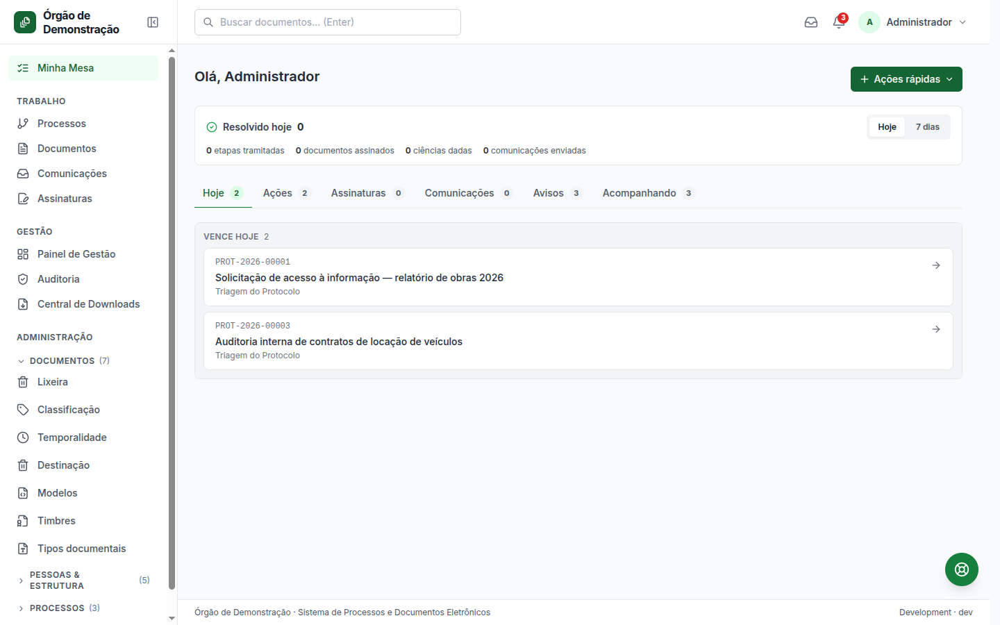 **Minha Mesa**: prazos, assinaturas e ciências | 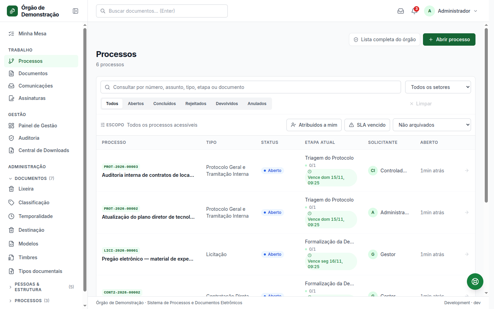 **Processos**: etapa atual, SLA e solicitante |
|  **Detalhe do processo**: documentos, tramitação e SLA | 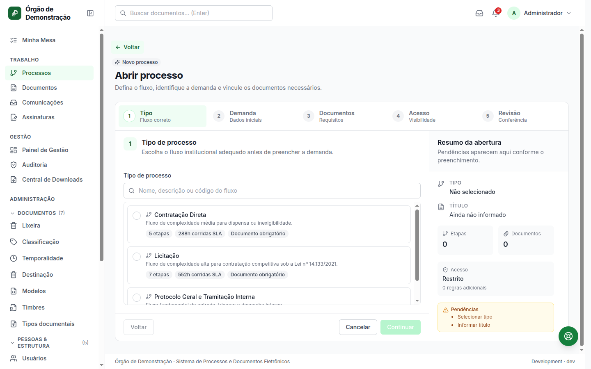 **Abertura de processo**: assistente guiado |
| 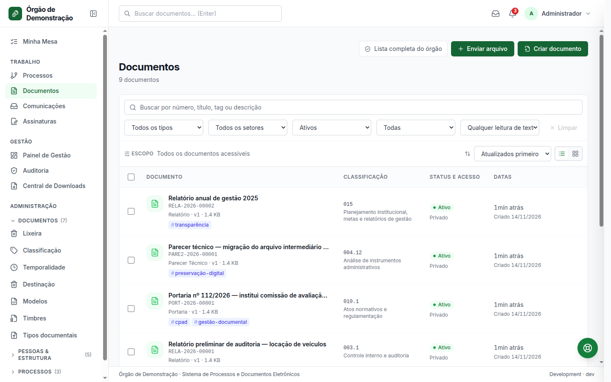 **Documentos**: classificação, acesso e versões | 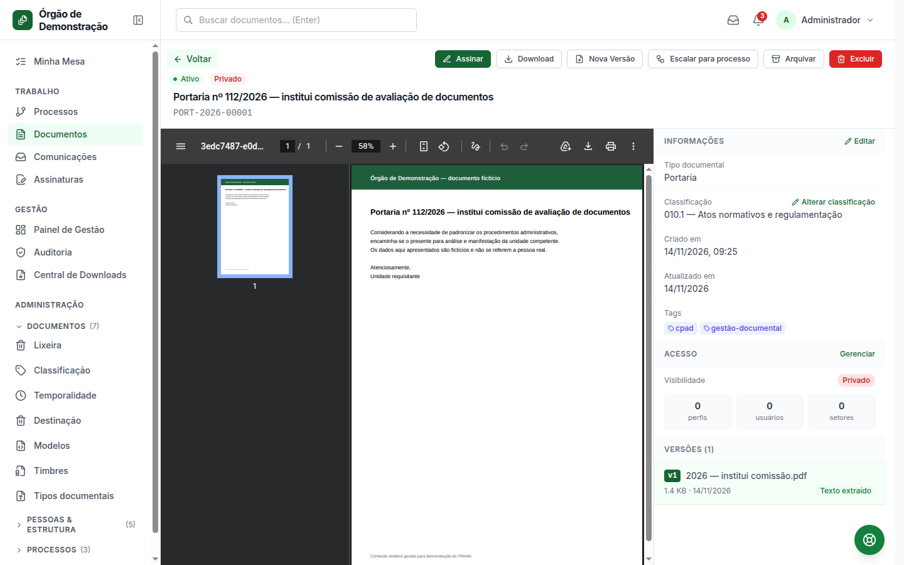 **Visualizador**: metadados, ACL e versões |
| 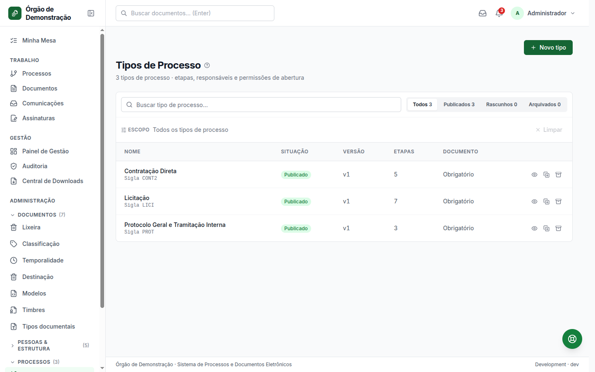 **Tipos de processo**: versionados e publicados | 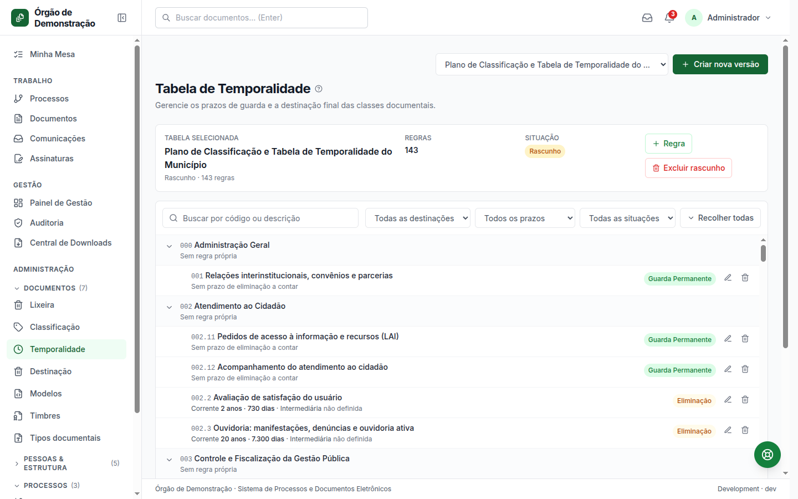 **Tabela de temporalidade**: prazos de guarda e destinação |
| 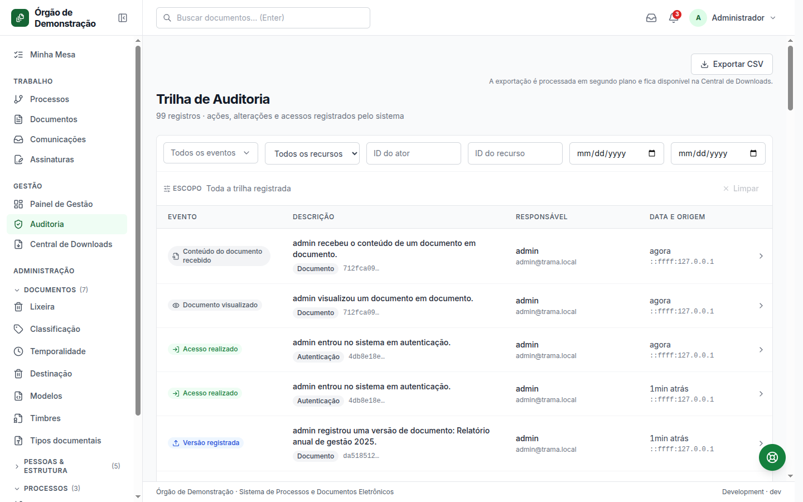 **Trilha de auditoria**: quem fez o quê, quando e de onde | 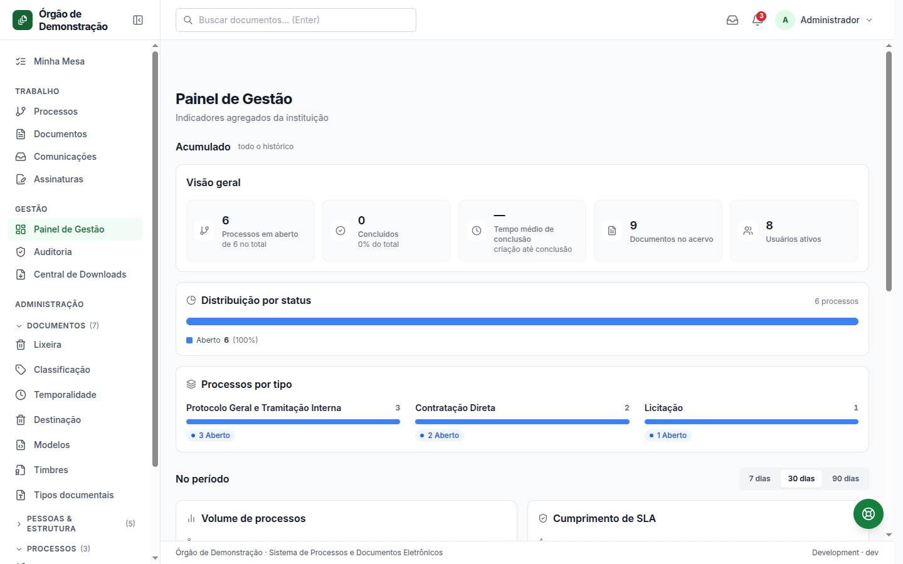 **Painel de gestão** |

---

## Sobre este repositório

- Nenhum dado de produção, credencial, hostname ou detalhe de infraestrutura
  está incluído.
- Os ADRs estão no idioma original. Referências a caminhos internos e IDs de
  achado apontam para o repositório privado.
- Contato: robertoromeu2009@gmail.com
