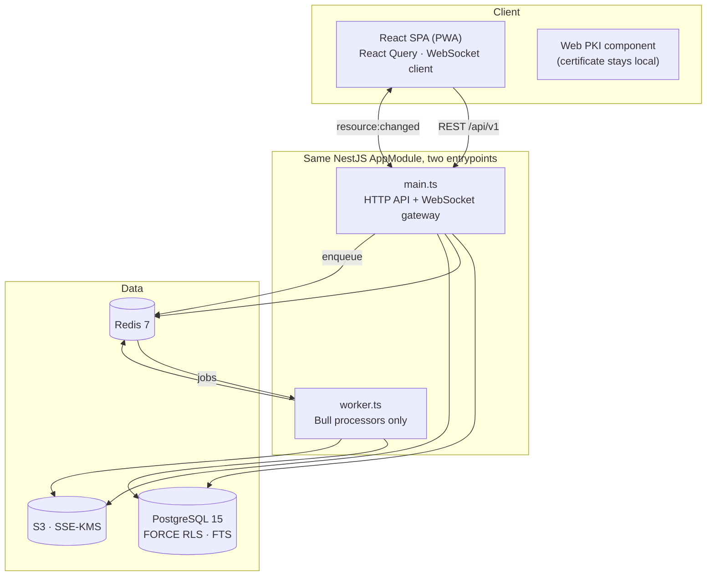
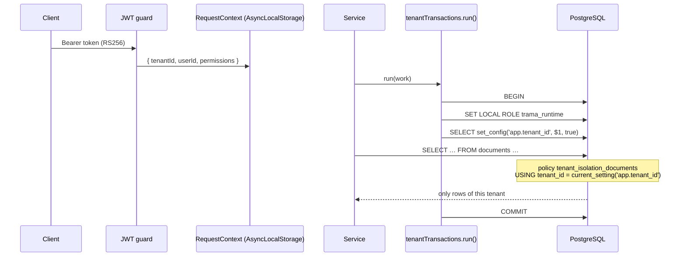
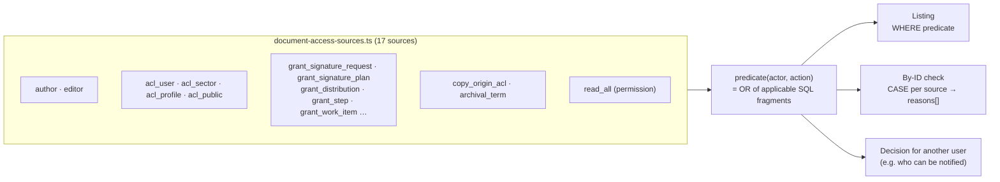
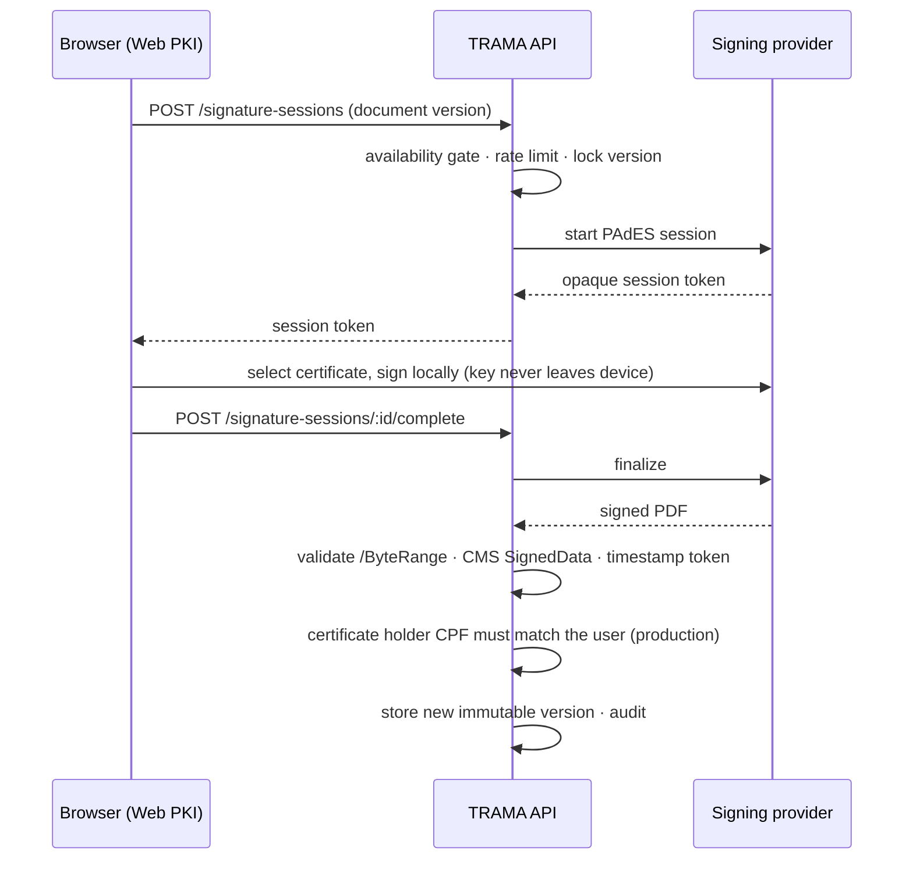

# TRAMA — Architecture Notes

This document expands the overview in the [README](../README.md). It describes
the current architecture of the private codebase at a level that is useful to
understand the design, without operational details.

## 1. Runtime topology

- **API and worker share the same module graph.** In development a single
  process does both. In production the worker boots `AppModule` without an HTTP
  server and only consumes queues: OCR, PDF stamping, thumbnails, search
  indexing, e-mail, authenticated exports, scheduled disposition and a
  heartbeat.
- **Stateless processes.** Configuration comes from the environment at
  runtime, identity from IAM roles (no long-lived static credentials), and
  objects go to S3 encrypted with KMS keys per environment.
- **Real time** ([ADR-026]): the server emits a `resource:changed` event per
  resource through a Redis-backed Socket.IO adapter. The client invalidates
  only the affected queries. If the socket is down, screens degrade to normal
  fetching.

## 2. Multi-tenancy: isolation by the database, not by discipline

Three layers keep a query from crossing tenants:

1. **Application**: every query of tenant data filters by `tenantId` taken
   from the authenticated context. The tenant ID is never read from the request body.
2. **Database**: tenant-scoped tables have `FORCE ROW LEVEL SECURITY` with
   `USING` and `WITH CHECK` on `app.tenant_id`, and the runtime login is a
   restricted role, so even a missing `WHERE` returns nothing from another tenant.
3. **Tooling**: a custom type-aware ESLint rule ([ADR-021]) rejects any
   TypeORM repository call outside `tenantTransactions.run()`, the only place
   where `app.tenant_id` is set.

## 3. Authorization: from scattered checks to one predicate

Early on, "can this actor read this document?" existed in four copies (list
filter, by-ID check, search adapter, process records). Each new access path
had to be propagated by hand, and several defects came from a path
that reached only some of the copies.

[ADR-048] replaced this with an **access-source catalog per domain**:

- Each source declares the actions it grants, its reach (whole document or only
  the versions of an act), its permission gate and when it stops being valid.
- An empty set of sources yields `(1 = 0)`. The policy **fails closed**.
- The by-ID check returns *which* sources matched, which makes denials and
  grants explainable in tests and in the audit trail.

On top of that, [ADR-049] made the **route-level** contract explicit: a typed
matrix with all 304 routes (decorator, resource policies, domain links, what
each route mutates and which lifecycle states block it). A structural test
compares the matrix with Nest's route metadata. Executable cases then prove
each declared protection by **source differential**: the same request is
allowed with the source and denied without it, against a real PostgreSQL.

## 4. Documents, versions and signatures

- **Immutability belongs to the version** ([ADR-036]). Any evidence (signature,
  stamp, distribution) on a version freezes that version's bytes. The document
  can still receive new versions unless it has been issued: issued documents
  are corrected only through formal rectification ([ADR-045]).
- **Signature plans** orchestrate participants, order (sequential or parallel)
  and frozen document versions/hashes. A workflow step that requires signatures
  is approved only when its plan completes. There is no manual approval button.
- **ICP-Brasil signatures through a bridge** ([ADR-023], [ADR-042]):

The backend never receives a `.pfx`, a password, a PIN or a private key. This
is a permanent rule, and reopening it requires a new ADR.

## 5. Records management

- **Classification plan** (hierarchical, only leaf activities receive documents)
  is the single taxonomy ([ADR-028], [ADR-032]); retention derives exclusively
  from classification.
- **Retention schedule** versions are drafted and activated by the records
  committee. Disposition batches go through submit → approve → schedule →
  execute. Eligibility is revalidated before
  physical execution, and an active hold blocks elimination.
- **Process as archival unit** ([ADR-043]): every document has an owner process.
  Attaching ("juntada") either moves or copies, and the choice is explicit.
  Removed pieces stay as history.

## 6. Delivery and operations

- Images are built outside the instance and promoted by immutable tags ([ADR-037]).
- AWS infrastructure is declared in Terraform ([ADR-025]): S3 with SSE-KMS
  only, IAM roles per component, separate keys and buckets per environment.
- The health endpoint reports the deployed commit, and validation in
  staging starts by confirming it.
- Backup/restore and disaster-recovery drills are scripted and their evidence
  recorded.

[ADR-021]: adrs/README.md
[ADR-023]: adrs/README.md
[ADR-025]: adrs/README.md
[ADR-026]: adrs/README.md
[ADR-028]: adrs/README.md
[ADR-032]: adrs/README.md
[ADR-036]: adrs/ADR-036-imutabilidade-documental-e-da-versao.md
[ADR-037]: adrs/README.md
[ADR-042]: adrs/ADR-042-lacuna-como-via-unica-de-assinatura-icp-brasil.md
[ADR-043]: adrs/README.md
[ADR-045]: adrs/README.md
[ADR-048]: adrs/ADR-048-politica-de-acesso-por-recurso.md
[ADR-049]: adrs/ADR-049-matriz-de-acesso-por-rota.md
